# Jarvis

Your own command center for AI: an assistant you can talk to, a team of agents you design, your projects, notes (Obsidian), code (VS Code), iMessage, a council of AIs, and apps for Mac, iPhone, Apple Watch and CarPlay. It runs on your Mac with your own AI accounts, and nothing you do is shared with anyone.

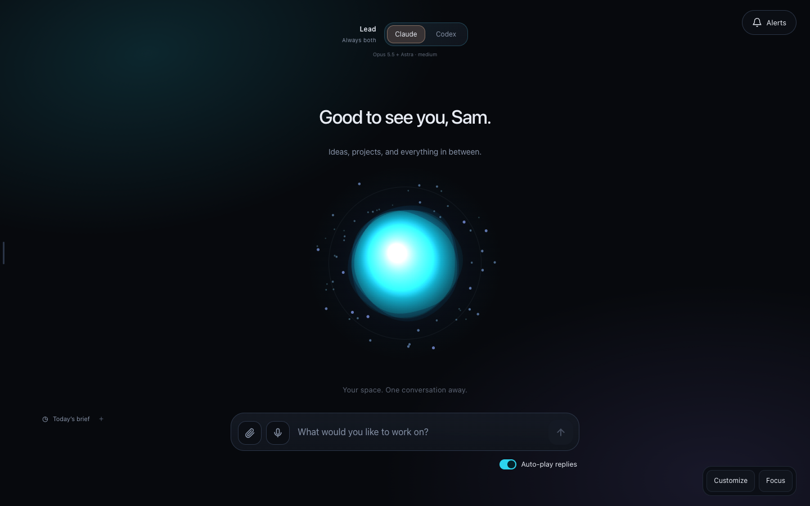

**New here? Open [`START-HERE.md`](START-HERE.md).** Want an AI to set it up with you? Open [`PASTE-THIS-INTO-YOUR-AI.md`](PASTE-THIS-INTO-YOUR-AI.md).

## What it looks like
*(Screenshots from a demo setup: user "Sam", assistant "Nova". Yours will carry your own name, projects and colors.)*

| | |
|---|---|
| **Agent team** — an assistant that hands work to specialists, with plans you approve 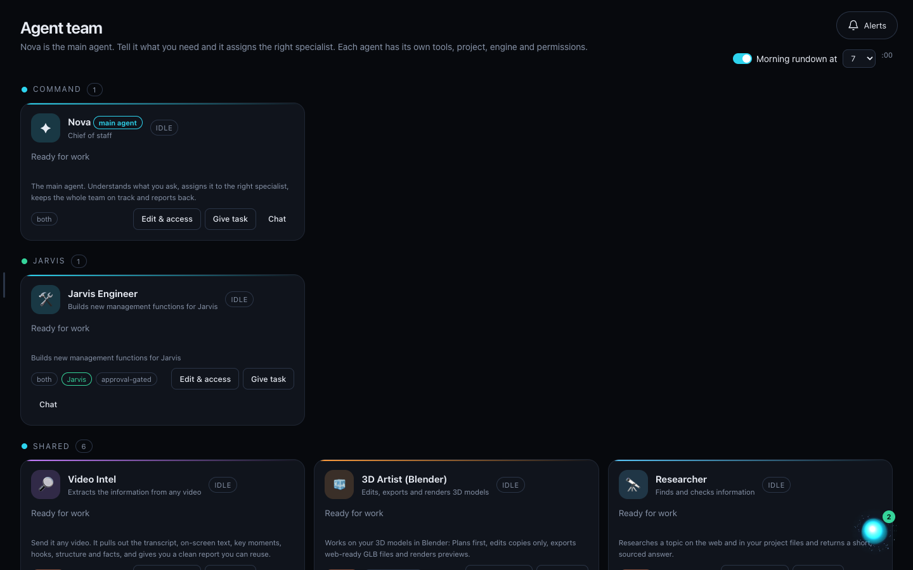 | **Projects** — every project, its files and its agents in one place 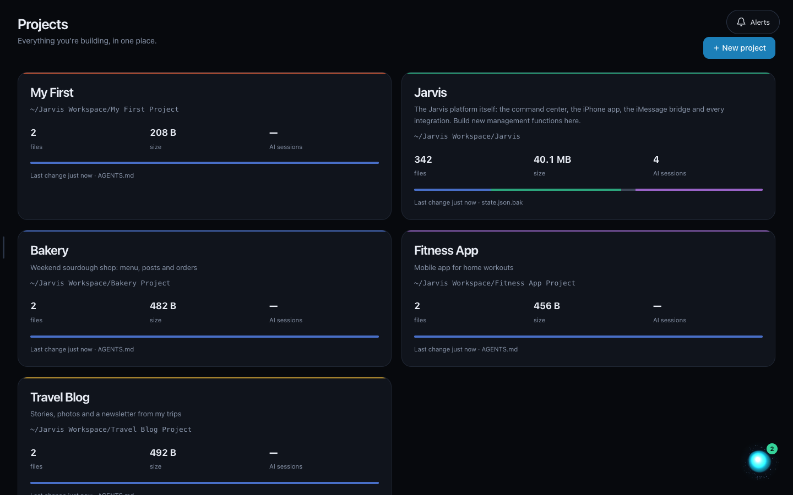 |
| **AI Models** — connect Claude, Codex, Gemini or any API key and choose who does what 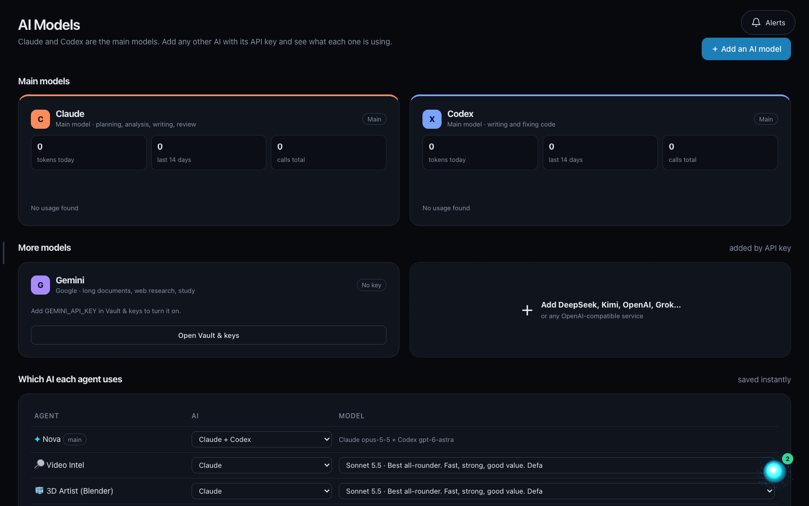 | **Council** — several AIs answer a big question and review each other 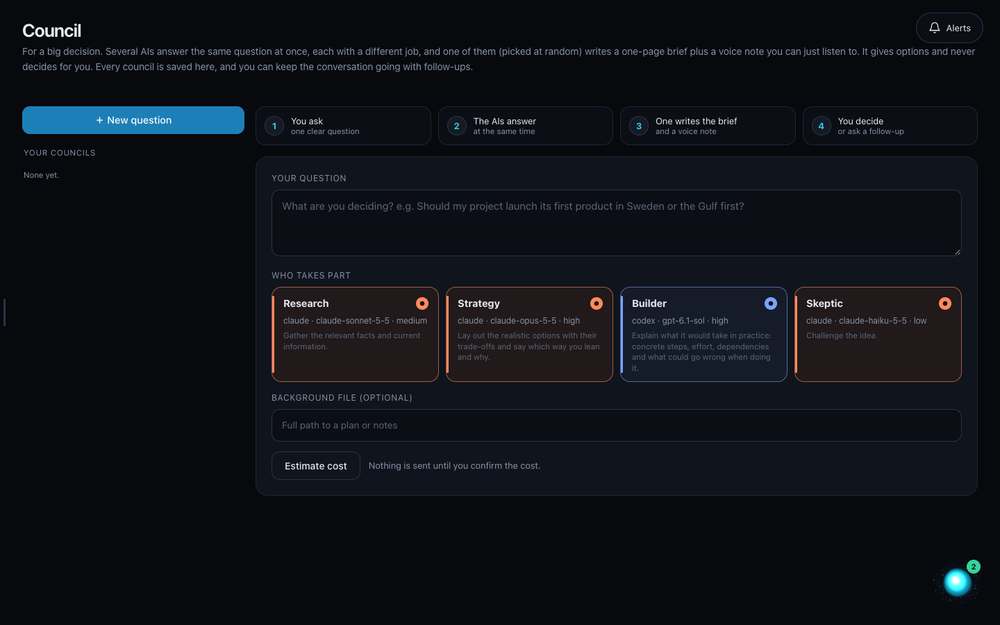 |
| **Obsidian, VS Code, iMessage** — your notes, code and texting, connected 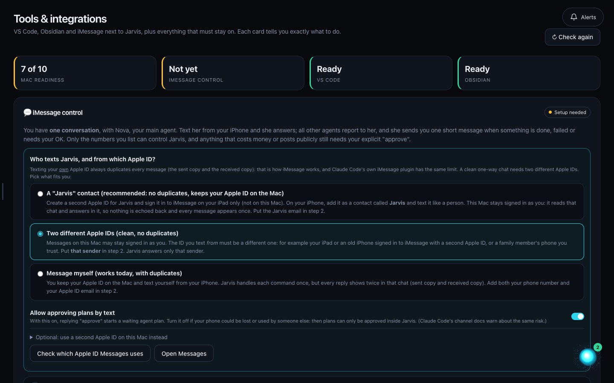 | **Knowledge graph** — all your notes and files as a living map 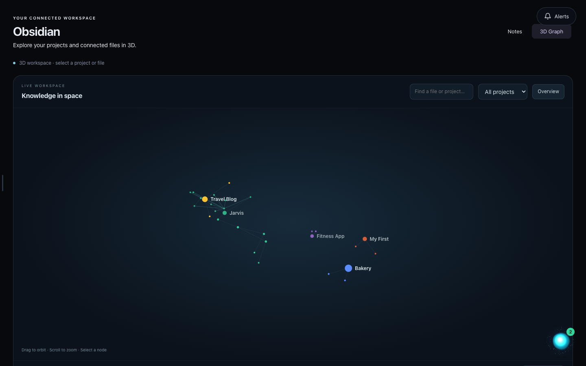 |

### On your phone, watch and in the car

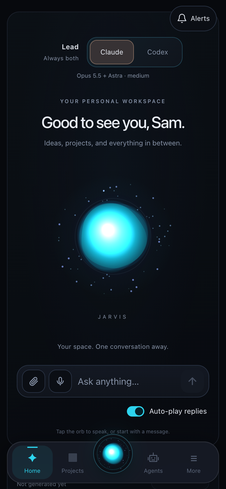 &nbsp;
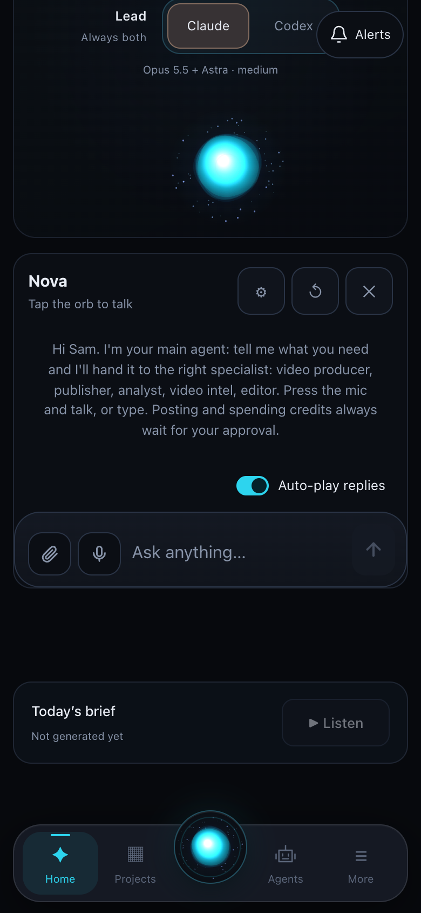 &nbsp;
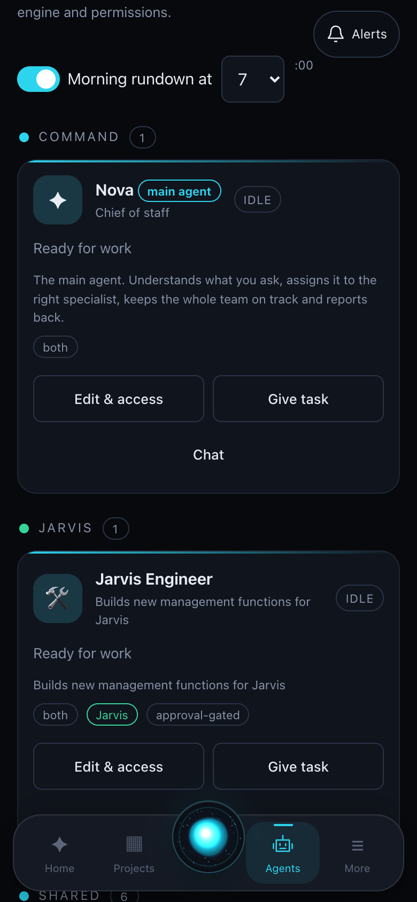

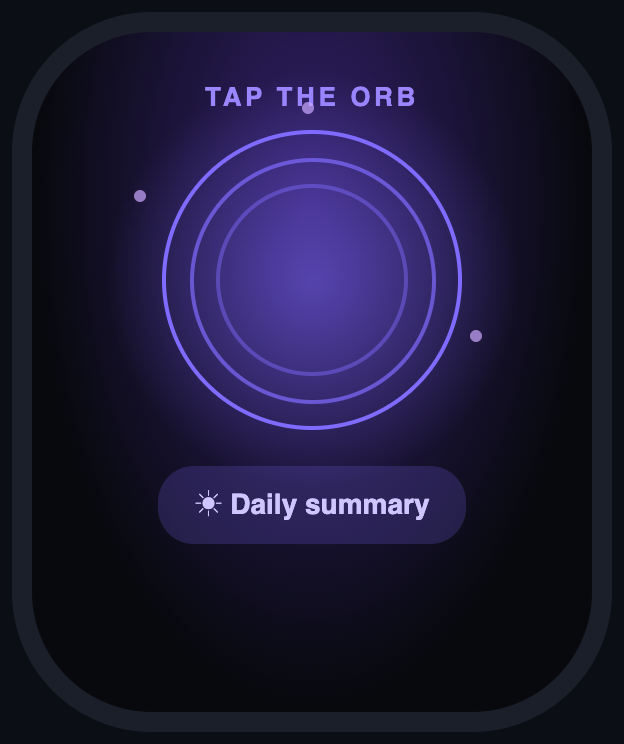 &nbsp;
 
Apple Watch and CarPlay screens are illustrations of the real screens.

## What is inside
The interface and design, projects, agent builder, skills, council, lead-AI switch (Claude / Codex / both), Obsidian, VS Code and iMessage integrations, voice, the Mac, iPhone and Watch apps and the CarPlay screen.
**Not inside:** anyone's keys, accounts, agents, skills, chats, projects or personal data. See [`docs/PRIVACY.md`](docs/PRIVACY.md).

## License
MIT: use it, change it, share it. See [`LICENSE`](LICENSE). It runs on your own computer with your own AI accounts; you are responsible for how you use those accounts and the apps you build.

## Guides
[Start here](START-HERE.md) · [iPhone](docs/IPHONE.md) · [Apple Watch](docs/WATCH.md) · [CarPlay](docs/CARPLAY.md) · [Mac app](docs/MAC-APP.md) · [Customize](docs/CUSTOMIZE.md) · [Privacy](docs/PRIVACY.md)
