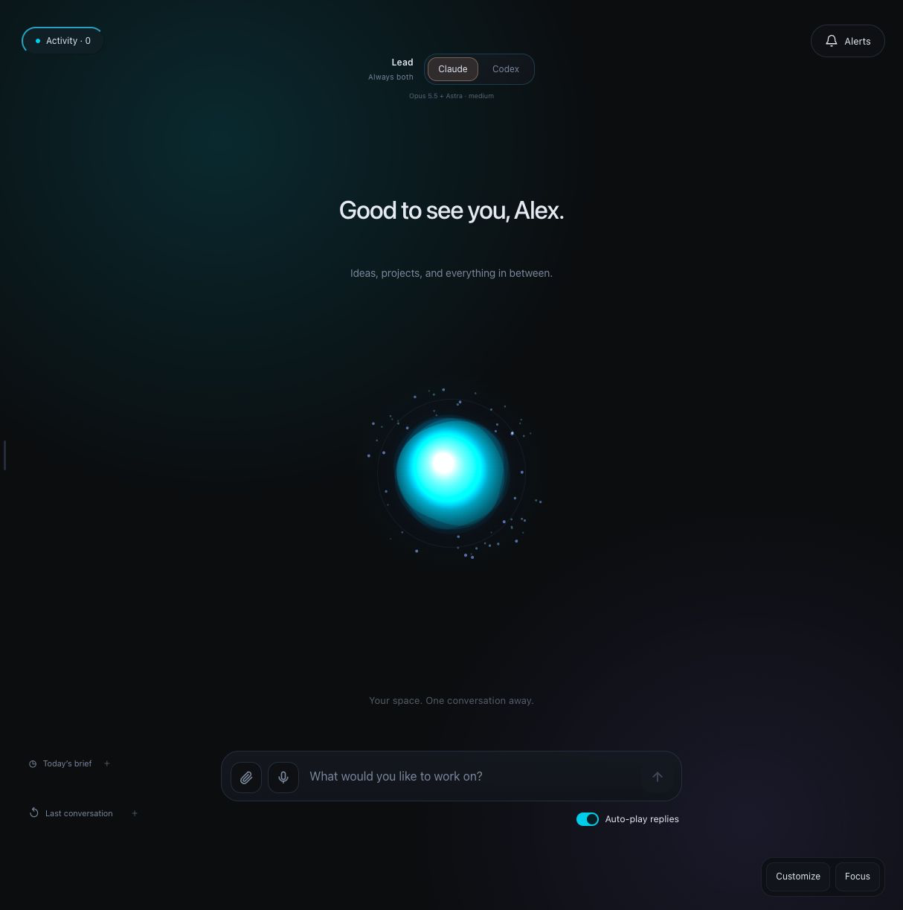
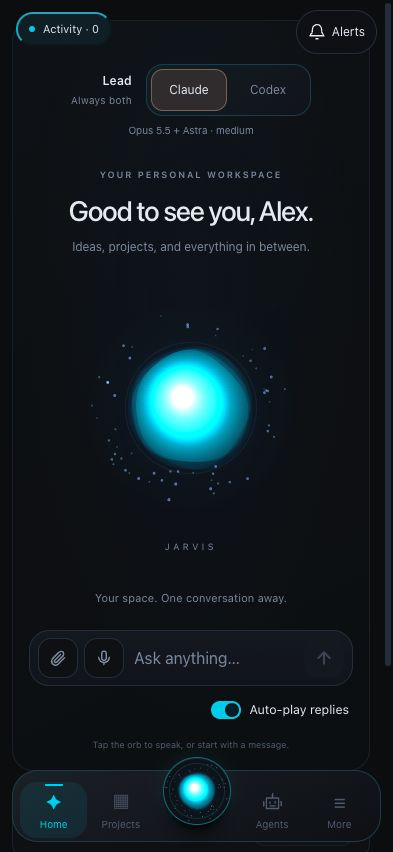
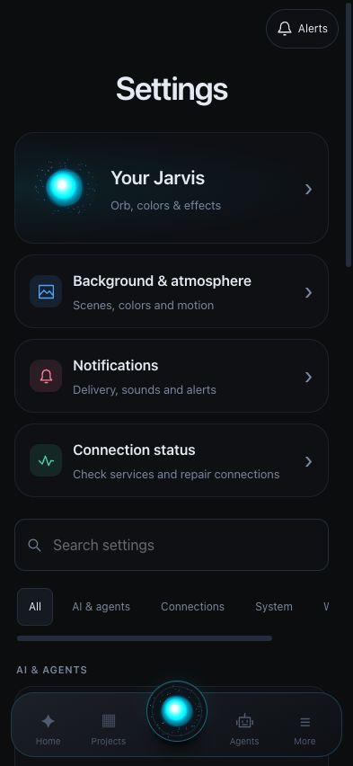
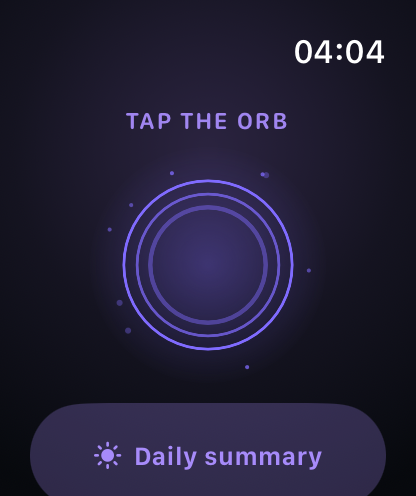
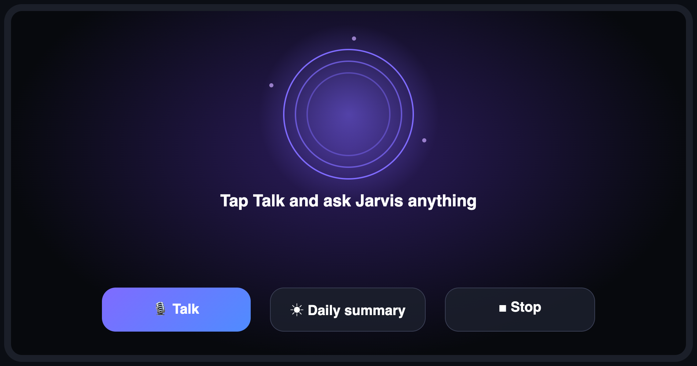

# Jarvis

Your own command center for AI: an assistant you can talk to, a team of agents you design, your projects, notes (Obsidian), code (VS Code), iMessage, a council of AIs, and apps for Mac, iPhone, Apple Watch and CarPlay. It runs on your Mac with your own AI accounts, and nothing you do is shared with anyone.

**New here? Open [`START-HERE.md`](START-HERE.md).** Want an AI to set it up with you? Open [`PASTE-THIS-INTO-YOUR-AI.md`](PASTE-THIS-INTO-YOUR-AI.md).

## Interface

Jarvis includes a customizable orb, responsive Home layout, agent workflow view, and grouped Settings on desktop and mobile. Desktop and phone screenshots were captured from an isolated demo with fictional user Alex and assistant Nova. The demo has no personal projects, conversations or connected accounts. The Apple Watch image is a native simulator capture of the public app in its generic idle state.

### Desktop

### iPhone

 &nbsp; 

### Apple Watch

### CarPlay

*CarPlay design preview, not a simulator or in-car screenshot. Actual Apple-controlled template layout varies by iOS version and head unit; Talk and Daily summary are primary actions, and Stop remains available in navigation when action buttons are limited.*

## What is inside
The interface and design, projects, agent builder, skills, council, lead-AI switch (Claude / Codex / both), Obsidian, VS Code and iMessage integrations, voice, the Mac, iPhone and Watch apps and the CarPlay screen.
**Not included as runtime data:** credentials, account sessions, private chats or project files. Gallery images contain fictional demo data or generic interface content only. See [`docs/PRIVACY.md`](docs/PRIVACY.md).

## License
MIT: use it, change it, share it. See [`LICENSE`](LICENSE). It runs on your own computer with your own AI accounts; you are responsible for how you use those accounts and the apps you build.

## Guides
[Start here](START-HERE.md) · [iPhone](docs/IPHONE.md) · [Apple Watch](docs/WATCH.md) · [CarPlay](docs/CARPLAY.md) · [Mac app](docs/MAC-APP.md) · [Customize](docs/CUSTOMIZE.md) · [Privacy](docs/PRIVACY.md)
